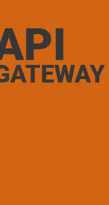

<p align="center"></p>

<h1 align="center">🌐 API Gateway</h1>

<p align="center"><em>ASP.NET Core reverse proxy with YARP and JWT authentication.</em></p>

<p align="center">🇧🇷 <a href="README.md">Português</a> | 🇺🇸 English</p>

<p align="center"> </p>

<p align="center"><a href="#sobre">About</a> • <a href="#tecnologias">Technologies</a> • <a href="#como-rodar">Running locally</a> • <a href="#licenca">License</a> • <a href="#autor">Author</a></p>

---

<a id="sobre"></a>
## 📖 About

NET 8 gateway using YARP to route HTTP requests to configured services. Includes JWT bearer validation and a demonstration endpoint for token generation. Routes and clusters are configured through application settings.

## ✨ Features

- YARP route forwarding
- JWT token validation
- Demonstration authentication endpoint

## 🛠️ Technologies

     

## 📦 Prerequisites

.NET 8 SDK. Configure `Jwt__Key` and your own downstream destinations.

<a id="como-rodar"></a>
## 🚀 Running locally

```bash
git clone https://github.com/Felipe-Amorim-Dev/APIGateway.git
cd APIGateway
dotnet restore APIGateWay.sln
dotnet build APIGateWay.sln
dotnet run --project APIGateWay.API
```

<a id="licenca"></a>
## 📄 License

Distributed under the [MIT license](LICENSE).

<a id="autor"></a>
## 👤 Author

**Felipe Figueiredo Amorim** — Full Stack Developer.

[](https://www.linkedin.com/in/felipe-amorim-dev/) [](mailto:felipe.f.amorim@outlook.com)

<p align="center"><strong>Obrigado por visitar! / Thanks for visiting!</strong></p>
